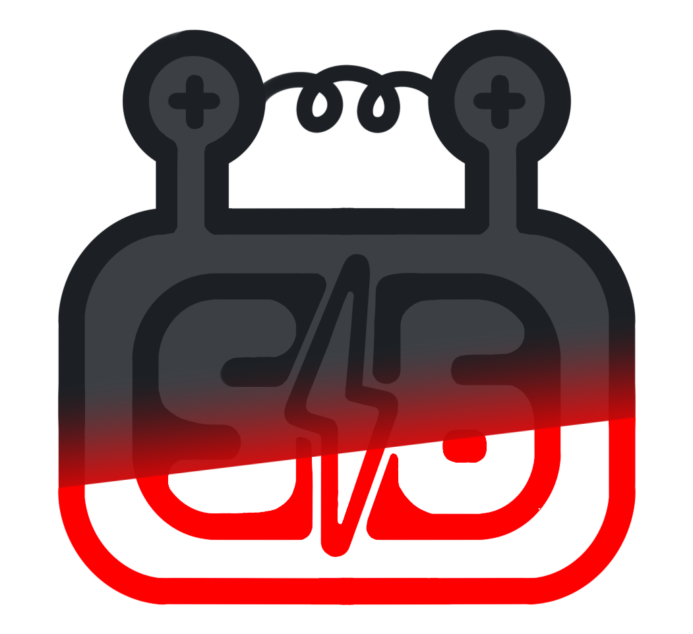

     
    <h1>Tumbler Ron</h1>
    
Offseason testing drivetrain based from <a href="https://github.com/StuyPulse/StuyPlus-2026/">Ron's</a> disassembled robot

## Features
- Swerve drivetrain w/ 4 Mk4i Swerve Modules 